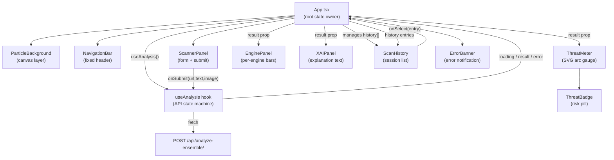
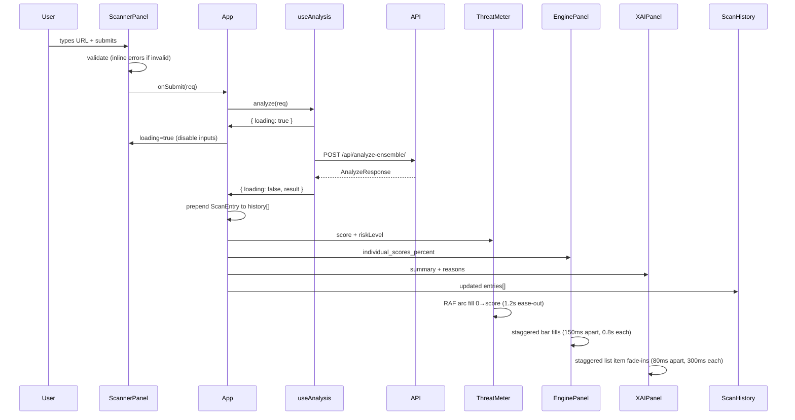

# Design Document: PhishGuard UI Overhaul

## Overview

The PhishGuard UI Overhaul transforms the existing single-file React application into a production-grade cybersecurity dashboard with a cyberpunk/glassmorphism aesthetic. The redesign introduces a component-based architecture across nine focused components, a custom `useAnalysis` hook for API state management, a centralized theme token file, and a shared TypeScript type layer — all while staying within a 150 KB gzipped bundle limit by avoiding external component libraries and relying entirely on native browser APIs (Canvas, SVG, CSS animations, Page Visibility API).

The technical approach prioritizes GPU-composited animations (transform + opacity only), CSS custom properties for theming, and a minimal dependency footprint. The ParticleBackground uses `requestAnimationFrame` with Page Visibility API pausing. The ThreatMeter uses an SVG `<circle>` with `stroke-dashoffset` driven by a JS RAF loop. All other animations are pure CSS keyframes.

---

## Architecture



---

## File / Directory Structure

```
frontend/
├── index.html                         (add Google Fonts @import)
├── vite.config.ts                     (add bundle-size warning plugin)
└── src/
    ├── main.tsx                       (unchanged entry point)
    ├── App.tsx                        (root state owner — refactored)
    ├── App.css                        (global layout only)
    ├── index.css                      (CSS reset + font-display rules)
    ├── theme.ts                       (color tokens, font families, durations)
    ├── types/
    │   └── api.ts                     (AnalyzeResponse, RiskLevel, etc.)
    ├── hooks/
    │   └── useAnalysis.ts             (API call state machine)
    └── components/
        ├── NavigationBar.tsx
        ├── NavigationBar.css
        ├── ParticleBackground.tsx     (canvas, no CSS file needed)
        ├── ScannerPanel.tsx
        ├── ScannerPanel.css
        ├── ThreatMeter.tsx            (SVG arc + JS animation)
        ├── ThreatMeter.css
        ├── ThreatBadge.tsx
        ├── ThreatBadge.css
        ├── EnginePanel.tsx
        ├── EnginePanel.css
        ├── XAIPanel.tsx
        ├── XAIPanel.css
        ├── ScanHistory.tsx
        ├── ScanHistory.css
        ├── ErrorBanner.tsx
        └── ErrorBanner.css
```

CSS approach decision: **plain CSS files co-located with each component** (no CSS Modules, no CSS-in-JS).

Rationale:
- Zero runtime overhead (vs. CSS-in-JS)
- No additional build config (vs. CSS Modules requiring `*.module.css` rename + type declarations)
- Scoping achieved by prefixing all selectors with a unique BEM-style component class (e.g., `.scanner-panel__input`)
- Theme tokens shared via CSS custom properties defined in `index.css` and consumed everywhere
- Bundle stays smaller — no styled-components or emotion runtime

---

## Theme Tokens (`src/theme.ts`)

```typescript
export const COLORS = {
  baseBg:         '#050508',
  neonCyan:       '#00e5ff',
  neonAmber:      '#ffa940',
  neonCrimson:    '#ff4d4f',
  neonGreen:      '#39ff14',
  glass:          'rgba(255, 255, 255, 0.04)',
  glassBorder:    'rgba(0, 229, 255, 0.15)',
  glassShadow:    '0 8px 32px rgba(0, 229, 255, 0.08)',
  text:           '#e0e0e0',
  textMuted:      'rgba(224, 224, 224, 0.7)',
} as const

export const FONTS = {
  body:    "'Inter', system-ui, sans-serif",
  heading: "'Orbitron', 'Share Tech Mono', monospace",
} as const

export const DURATIONS = {
  arcFill:        1200,   // ms — ThreatMeter arc ease-out fill
  barFill:        800,    // ms — EnginePanel bar fill
  barStagger:     150,    // ms — delay between each bar
  scanLine:       1200,   // ms — loading scan-line sweep loop
  spinner:        900,    // ms — loading arc rotation
  particleMin:    0.2,    // px/frame — slowest particle drift
  particleMax:    1.0,    // px/frame — fastest particle drift
  badgePulse:     1500,   // ms — phishing ThreatBadge glow pulse
  systemPulse:    2000,   // ms — "SYSTEM ONLINE" nav pulse
  xaiStagger:     80,     // ms — XAI list item fade-in delay
  xaiFade:        300,    // ms — each XAI item fade duration
  statusCycle:    1000,   // ms — loading status message rotation
} as const

export const SIZES = {
  navHeight:      64,     // px
  scannerMaxW:    680,    // px
  historyMax:     20,     // entries
  urlTruncate:    50,     // characters
  imageSizeLimit: 10 * 1024 * 1024,  // 10 MB in bytes
} as const

// Risk level → accent color mapping
export const RISK_COLORS: Record<string, string> = {
  safe:       COLORS.neonGreen,
  suspicious: COLORS.neonAmber,
  phishing:   COLORS.neonCrimson,
}
```

---

## API Types (`src/types/api.ts`)

```typescript
export type RiskLevel = 'safe' | 'suspicious' | 'phishing'

export interface AnalyzeRequest {
  url: string
  text?: string
  image?: File
}

export interface AnalyzeResponse {
  ensemble_risk_level: RiskLevel
  ensemble_score_percent: number          // 0–100
  xai_summary: string
  individual_scores_percent: Record<string, number>
  reasons: string[]
}

// Stored in ScanHistory state
export interface ScanEntry {
  id: string                              // crypto.randomUUID()
  timestamp: Date
  url: string
  result: AnalyzeResponse
}

// Shape returned by useAnalysis
export interface UseAnalysisState {
  loading: boolean
  result: AnalyzeResponse | null
  error: string | null
  analyze: (req: AnalyzeRequest) => Promise<void>
  reset: () => void
}
```

---

## Custom Hook (`src/hooks/useAnalysis.ts`)

```typescript
// State machine: idle → loading → (success | error) → idle
// analyze() transitions idle/error → loading
// reset() returns to idle from any state

interface State {
  loading: boolean
  result: AnalyzeResponse | null
  error: string | null
}

function useAnalysis(): UseAnalysisState {
  const [state, setState] = useState<State>({
    loading: false,
    result: null,
    error: null,
  })

  const analyze = async (req: AnalyzeRequest): Promise<void> => {
    setState({ loading: true, result: null, error: null })

    const formData = new FormData()
    formData.append('url', req.url)
    if (req.text)  formData.append('text', req.text)
    if (req.image) formData.append('image', req.image)

    try {
      // AbortController for 10s timeout (network failure definition per Req 8.2)
      const controller = new AbortController()
      const timer = setTimeout(() => controller.abort(), 10_000)

      const resp = await fetch('/api/analyze-ensemble/', {
        method: 'POST',
        body: formData,
        signal: controller.signal,
      })
      clearTimeout(timer)

      if (!resp.ok) {
        const err = await resp.json().catch(() => ({}))
        throw new Error(err.detail ?? `Server error ${resp.status}`)
      }

      const data: AnalyzeResponse = await resp.json()
      // Clamp score per Req 5.7
      data.ensemble_score_percent = Math.min(100, Math.max(0, data.ensemble_score_percent))

      setState({ loading: false, result: data, error: null })
    } catch (e: unknown) {
      const isNetwork = e instanceof DOMException && e.name === 'AbortError'
        || (e instanceof TypeError && e.message.includes('fetch'))
      const message = isNetwork
        ? 'Unable to reach the analysis server. Check your connection and try again.'
        : (e as Error).message

      setState({ loading: false, result: null, error: message })
    }
  }

  const reset = () => setState({ loading: false, result: null, error: null })

  return { ...state, analyze, reset }
}
```

**Preconditions:**
- `req.url` is a non-empty string with `http://` or `https://` scheme (validated in ScannerPanel before calling)
- `req.image`, if present, is ≤ 10 MB and of a valid MIME type (validated in ScannerPanel)

**Postconditions:**
- After `analyze()` resolves: exactly one of `result` or `error` is non-null; `loading` is false
- `reset()` sets all state fields to initial values

---

## Component Interfaces

### `NavigationBar`

```typescript
interface NavigationBarProps {
  // No external data props — self-contained with SYSTEM ONLINE animation
}

// Internal state: none (animation via CSS keyframes)
```

### `ParticleBackground`

```typescript
interface ParticleBackgroundProps {
  // No props — full-screen canvas, reads prefers-reduced-motion internally
}

// Internal state: particles array managed in useRef
```

### `ScannerPanel`

```typescript
interface ScannerPanelProps {
  loading: boolean
  onSubmit: (req: AnalyzeRequest) => void
}

// Internal state:
//   url: string
//   text: string
//   imageFile: File | null
//   showAdvanced: boolean
//   urlError: string
//   imageError: string
```

### `ThreatMeter`

```typescript
interface ThreatMeterProps {
  score: number        // 0–100, already clamped
  riskLevel: RiskLevel
}

// Internal state:
//   animatedScore: number  (driven by RAF loop, starts 0 → score)
```

### `ThreatBadge`

```typescript
interface ThreatBadgeBadgeProps {
  riskLevel: RiskLevel
  size?: 'normal' | 'small'   // 'small' for ScanHistory entries
}
```

### `EnginePanel`

```typescript
interface EnginePanelProps {
  scores: Record<string, number>   // individual_scores_percent
}

// Internal state:
//   animatedScores: Record<string, number>  (staggered RAF per bar)
```

### `XAIPanel`

```typescript
interface XAIPanelProps {
  summary: string
  reasons: string[]
}
```

### `ScanHistory`

```typescript
interface ScanHistoryProps {
  entries: ScanEntry[]
  onSelect: (entry: ScanEntry) => void
}

// Internal state:
//   expanded: boolean  (collapsed by default)
```

### `ErrorBanner`

```typescript
interface ErrorBannerProps {
  message: string
  onDismiss: () => void
}
```

---

## Data Flow Diagram



---

## ThreatMeter: SVG Arc Math

The gauge is a single SVG `<circle>` element styled as a stroke arc using `stroke-dasharray` / `stroke-dashoffset`.

```
SVG viewBox: 0 0 200 200
Circle: cx=100, cy=100, r=80
Circumference C = 2π × r = 2π × 80 ≈ 502.65 px

stroke-dasharray: C C          (total dash = full circumference)
stroke-dashoffset: C × (1 - score/100)

score=0   → dashoffset = C     (no arc visible)
score=50  → dashoffset = C/2   (half arc)
score=100 → dashoffset = 0     (full arc)
```

The arc starts at the 12 o'clock position. To rotate the SVG `<circle>` so the arc begins at the top-left (270° from 3 o'clock default), apply `transform: rotate(-90deg)` with `transform-origin: center`.

**Arc animation algorithm (RAF-driven):**

```typescript
// ALGORITHM animateArc
// INPUT: targetScore (0-100), durationMs, color
// OUTPUT: animatedScore state updates (side effects on SVG dashoffset)

function animateArc(
  circleEl: SVGCircleElement,
  targetScore: number,
  durationMs: number
): void {
  const C = 2 * Math.PI * 80
  const startTime = performance.now()

  function easeOut(t: number): number {
    return 1 - Math.pow(1 - t, 3)   // cubic ease-out
  }

  function step(now: number): void {
    const elapsed = now - startTime
    const t = Math.min(elapsed / durationMs, 1)
    const easedT = easeOut(t)
    const currentScore = easedT * targetScore

    // Update dashoffset
    const offset = C * (1 - currentScore / 100)
    circleEl.style.strokeDashoffset = String(offset)

    // Update center text (passed via React state setter)
    setAnimatedScore(Math.round(currentScore))

    if (t < 1) requestAnimationFrame(step)
  }

  requestAnimationFrame(step)
}
```

**Preconditions:** `targetScore` is clamped to [0, 100]; `circleEl` is mounted in DOM

**Postconditions:** After `durationMs` ms, `strokeDashoffset` equals `C × (1 - targetScore/100)` exactly; center text equals `Math.round(targetScore)`

**prefers-reduced-motion:** When detected, skip the RAF loop entirely and set `strokeDashoffset` to the final value in a single synchronous call.

---

## ParticleBackground: Canvas Particle System Design

```typescript
interface Particle {
  x: number          // current x in canvas pixels
  y: number          // current y in canvas pixels
  vx: number         // velocity x: range [-speed, +speed]
  vy: number         // velocity y: range [-speed, +speed]
  speed: number      // 0.2–1.0 px/frame (randomised at init)
  radius: number     // 1–2 px
  alpha: number      // 0.04–0.08 (NeonCyan at low opacity)
}

// ALGORITHM initParticles
// INPUT: canvas width W, canvas height H
// OUTPUT: Particle[]
//
// particleCount = Math.floor((W * H) / 12000)   // ~1 per 12k px² ≈ 130 on 1920×800
// FOR i IN 0..particleCount:
//   speed = random(0.2, 1.0)
//   angle = random(0, 2π)
//   particles[i] = {
//     x: random(0, W), y: random(0, H),
//     vx: cos(angle) × speed, vy: sin(angle) × speed,
//     speed, radius: random(1, 2), alpha: random(0.04, 0.08)
//   }

// ALGORITHM drawFrame
// INPUT: ctx CanvasRenderingContext2D, particles Particle[], W, H
//
// ctx.clearRect(0, 0, W, H)
// FOR each particle p:
//   p.x += p.vx
//   p.y += p.vy
//   IF p.x < 0 THEN p.x = W    // wrap edges
//   IF p.x > W THEN p.x = 0
//   IF p.y < 0 THEN p.y = H
//   IF p.y > H THEN p.y = 0
//   ctx.beginPath()
//   ctx.arc(p.x, p.y, p.radius, 0, 2π)
//   ctx.fillStyle = `rgba(0, 229, 255, ${p.alpha})`
//   ctx.fill()
```

**Page Visibility API pause:**

```typescript
// In useEffect:
const handleVisibility = () => {
  if (document.hidden) cancelAnimationFrame(rafIdRef.current)
  else rafIdRef.current = requestAnimationFrame(loop)
}
document.addEventListener('visibilitychange', handleVisibility)
```

**Resize handling:** `ResizeObserver` on the canvas container resets canvas dimensions and re-initialises particles when the container size changes.

**prefers-reduced-motion:** When `window.matchMedia('(prefers-reduced-motion: reduce)').matches` is true, render the canvas with a static snapshot of particles (no RAF loop).

---

## CSS Architecture

### Global Custom Properties (`index.css`)

```css
:root {
  /* Colors */
  --color-base-bg:       #050508;
  --color-neon-cyan:     #00e5ff;
  --color-neon-amber:    #ffa940;
  --color-neon-crimson:  #ff4d4f;
  --color-neon-green:    #39ff14;
  --color-text:          #e0e0e0;
  --color-text-muted:    rgba(224, 224, 224, 0.7);

  /* Glass */
  --glass-bg:     rgba(255, 255, 255, 0.04);
  --glass-border: rgba(0, 229, 255, 0.15);
  --glass-shadow: 0 8px 32px rgba(0, 229, 255, 0.08);

  /* Fonts */
  --font-body:    'Inter', system-ui, sans-serif;
  --font-heading: 'Orbitron', 'Share Tech Mono', monospace;

  /* Durations */
  --dur-arc:       1200ms;
  --dur-bar:       800ms;
  --dur-scan-line: 1200ms;
  --dur-spinner:   900ms;
  --dur-badge-pulse: 1500ms;
  --dur-nav-pulse: 2000ms;

  /* Nav */
  --nav-height: 64px;
}

@media (prefers-reduced-motion: reduce) {
  *, *::before, *::after {
    animation-duration: 0.01ms !important;
    animation-iteration-count: 1 !important;
    transition-duration: 0.01ms !important;
  }
}
```

### Font Loading (`index.html` `<head>`)

```html
<link rel="preconnect" href="https://fonts.googleapis.com" />
<link rel="preconnect" href="https://fonts.gstatic.com" crossorigin />
<link
  href="https://fonts.googleapis.com/css2?family=Inter:wght@400;500;600&family=Orbitron:wght@700;900&display=swap"
  rel="stylesheet"
/>
```

`display=swap` is baked into the Google Fonts URL parameter. This satisfies the `font-display: swap` requirement without additional CSS.

### Glassmorphism Card (reusable class in `index.css`)

```css
.glass-card {
  background: var(--glass-bg);
  backdrop-filter: blur(16px);
  -webkit-backdrop-filter: blur(16px);
  border: 1px solid var(--glass-border);
  box-shadow: var(--glass-shadow);
  border-radius: 16px;
}
```

---

## Animation Strategy Per Component

| Component | Mechanism | Properties animated | Notes |
|---|---|---|---|
| `ParticleBackground` | JS RAF (canvas) | x, y per particle | Pauses on `visibilitychange`; disabled on `prefers-reduced-motion` |
| `NavigationBar` (SYSTEM ONLINE) | CSS keyframe | `opacity`, `transform: scale` | 2s pulse loop |
| `ScannerPanel` (loading scan-line) | CSS keyframe | `transform: translateY` | Runs only during `loading=true` |
| `ScannerPanel` (spinner) | CSS keyframe | `transform: rotate` | 0.9s infinite during loading |
| `ThreatMeter` (arc fill) | JS RAF | `stroke-dashoffset` (SVG attribute via JS) | 1.2s ease-out; state setter updates center text; disabled on `prefers-reduced-motion` |
| `ThreatBadge` (phishing pulse) | CSS keyframe | `box-shadow` spread | 1.5s infinite; only active when `riskLevel === 'phishing'` |
| `EnginePanel` (bar fills) | CSS animation with `--bar-target` custom property + stagger via `animation-delay` | `transform: scaleX` | Stagger achieved via inline style `--delay` × index |
| `XAIPanel` (staggered fade-in) | CSS keyframe + inline `animation-delay` | `opacity`, `transform: translateY(8px)→0` | 80ms stagger per list item |
| `ScanHistory` (expand/collapse) | CSS transition | `max-height`, `opacity` | `max-height: 0 → max-height: 600px` with overflow hidden |
| `ErrorBanner` (enter) | CSS keyframe | `opacity`, `transform: translateY(-8px)→0` | Dismissed via class removal |

### CSS Keyframe Definitions (in `index.css`)

```css
@keyframes pg-pulse {
  0%, 100% { opacity: 1; transform: scale(1); }
  50%       { opacity: 0.4; transform: scale(0.95); }
}

@keyframes spin {
  to { transform: rotate(360deg); }
}

@keyframes scan-sweep {
  0%   { transform: translateY(-100%); }
  100% { transform: translateY(100vh); }
}

@keyframes badge-pulse {
  0%, 100% { box-shadow: 0 0 4px 4px rgba(255, 77, 79, 0.6); }
  50%       { box-shadow: 0 0 16px 16px rgba(255, 77, 79, 0.3); }
}

@keyframes fade-up {
  from { opacity: 0; transform: translateY(8px); }
  to   { opacity: 1; transform: translateY(0); }
}

@keyframes banner-enter {
  from { opacity: 0; transform: translateY(-8px); }
  to   { opacity: 1; transform: translateY(0); }
}
```

---

## EnginePanel: Staggered Bar Fill Strategy

The bar fill avoids JS animation entirely by using a CSS trick with custom properties:

```css
/* Each bar wrapper sets --delay and --target-width via inline style */
.engine-bar__fill {
  width: 0%;
  transform-origin: left;
  animation: bar-fill var(--dur-bar) ease-out forwards;
  animation-delay: var(--delay, 0ms);
}

@keyframes bar-fill {
  to { width: var(--target-width, 0%); }
}
```

In TSX:
```typescript
{Object.entries(scores).map(([name, score], index) => (
  <div
    key={name}
    className="engine-bar__fill"
    style={{
      '--delay': `${index * DURATIONS.barStagger}ms`,
      '--target-width': `${Math.round(score)}%`,
    } as React.CSSProperties}
  />
))}
```

Note: animating `width` causes layout recalculation. To satisfy the performance requirement (transform+opacity only), use `transform: scaleX()` instead:

```css
.engine-bar__fill {
  width: 100%;                           /* always full container width */
  transform: scaleX(0);
  transform-origin: left;
  animation: bar-fill var(--dur-bar) ease-out forwards;
  animation-delay: var(--delay, 0ms);
}

@keyframes bar-fill {
  to { transform: scaleX(var(--target-scale, 0)); }
}
```

`--target-scale` = `score / 100` (e.g., 75% score → `scaleX(0.75)`).

---

## App.tsx: Root State Layout

```typescript
// App.tsx manages:
//   - useAnalysis() hook results
//   - history: ScanEntry[] (max 20, prepend new entries)
//   - activeEntry: ScanEntry | null (from history selection)
//   - dismissedError: boolean (reset on new submission)

// Derived display state:
//   displayResult = activeEntry?.result ?? analysis.result

function App() {
  const analysis = useAnalysis()
  const [history, setHistory] = useState<ScanEntry[]>([])
  const [activeEntry, setActiveEntry] = useState<ScanEntry | null>(null)

  // When a new result arrives, prepend to history
  useEffect(() => {
    if (!analysis.result) return
    const entry: ScanEntry = {
      id: crypto.randomUUID(),
      timestamp: new Date(),
      url: lastUrl,          // captured via ref when onSubmit fires
      result: analysis.result,
    }
    setHistory(prev => [entry, ...prev].slice(0, SIZES.historyMax))
    setActiveEntry(null)     // clear history selection so live result shows
  }, [analysis.result])

  const handleSubmit = (req: AnalyzeRequest) => {
    setActiveEntry(null)     // clear active history entry
    analysis.analyze(req)
  }

  const displayResult = activeEntry?.result ?? analysis.result

  return (
    <>
      <ParticleBackground />
      <NavigationBar />
      <main>
        {analysis.error && !activeEntry && (
          <ErrorBanner message={analysis.error} onDismiss={analysis.reset} />
        )}
        <ScannerPanel loading={analysis.loading} onSubmit={handleSubmit} />
        {displayResult && (
          <>
            <ThreatMeter
              score={displayResult.ensemble_score_percent}
              riskLevel={displayResult.ensemble_risk_level}
            />
            <EnginePanel scores={displayResult.individual_scores_percent} />
            <XAIPanel
              summary={displayResult.xai_summary}
              reasons={displayResult.reasons}
            />
          </>
        )}
        {history.length > 0 && (
          <ScanHistory entries={history} onSelect={setActiveEntry} />
        )}
      </main>
    </>
  )
}
```

---

## Vite Config Changes (`vite.config.ts`)

```typescript
import { defineConfig } from 'vite'
import react from '@vitejs/plugin-react'

export default defineConfig({
  plugins: [react()],
  build: {
    // Emit a warning when any chunk exceeds 150 KB gzipped.
    // The built-in chunkSizeWarningLimit uses kB (uncompressed).
    // Gzip ratio for React code is ~3:1, so 150 KB gzip ≈ 450 KB raw.
    // Set threshold conservatively at 200 KB raw to catch problems early.
    chunkSizeWarningLimit: 200,  // kB uncompressed (~150 KB gzipped)
    rollupOptions: {
      output: {
        // Split vendor (react + react-dom) into separate chunk
        // so the app chunk alone can be measured against the 150 KB limit
        manualChunks: {
          vendor: ['react', 'react-dom'],
        },
      },
    },
  },
})
```

**Bundle size strategy:**
- React + ReactDOM (vendor chunk): ~45 KB gzipped — excluded from the 150 KB app limit
- App code + components: target < 150 KB gzipped
- No charting libraries (SVG arc hand-rolled)
- No animation libraries (CSS keyframes + minimal RAF code)
- No icon libraries (inline SVG or Unicode symbols for the XAI icons)
- Fonts: loaded from Google CDN, not bundled

**To enforce the limit at CI time:** Add a `scripts/check-bundle-size.mjs` script that reads `dist/assets/`, calculates gzip size of non-vendor JS chunks, and exits non-zero if > 150 KB. Run as `npm run build && node scripts/check-bundle-size.mjs`.

---

## Loading State: Status Messages Cycle

```typescript
const LOADING_MESSAGES = [
  'Resolving domain…',
  'Running ML classifier…',
  'Analyzing NLP signals…',
  'Fusing ensemble scores…',
] as const

// Inside ScannerPanel, when loading=true:
// useEffect cycles through messages using setInterval(fn, DURATIONS.statusCycle)
// Clears interval when loading becomes false
```

---

## XAIPanel: Threat Keyword Detection

```typescript
const THREAT_KEYWORDS = [
  'phishing', 'suspicious', 'malicious', 'fake',
  'spoofed', 'fraudulent', 'deceptive',
] as const

function classifyReason(reason: string): 'threat' | 'safe' {
  const lower = reason.toLowerCase()
  return THREAT_KEYWORDS.some(kw => lower.includes(kw)) ? 'threat' : 'safe'
}

// 'threat' → NeonCrimson warning icon (⚠ or inline SVG)
// 'safe'   → NeonGreen check icon (✓ or inline SVG)
```

---

## ScanHistory: Entry Display

```typescript
function formatTimestamp(d: Date): string {
  return d.toLocaleTimeString('en-GB', {
    hour: '2-digit', minute: '2-digit', second: '2-digit', hour12: false,
  })
  // Returns HH:MM:SS
}

function truncateUrl(url: string, max = SIZES.urlTruncate): string {
  return url.length > max ? url.slice(0, max) + '…' : url
}

// Score displayed: Math.round(entry.result.ensemble_score_percent * 10) / 10
// → one decimal place per Req 9.3
```

---

## Accessibility Implementation Notes

- `NavigationBar`: `<nav role="navigation" aria-label="Main navigation">`
- `ScannerPanel` collapsible Advanced Options: `<button aria-expanded={showAdvanced} aria-controls="advanced-options-panel">`; panel `<div id="advanced-options-panel" hidden={!showAdvanced}>`
- `ScanHistory` collapsible: `<button aria-expanded={expanded} aria-controls="scan-history-list">SCAN HISTORY ({entries.length})</button>`; `aria-live="polite"` on history list for screen reader announcements when new entries appear
- `ThreatMeter`: wrap in `<figure aria-label={`Threat score: ${score}% — ${riskLevel}`}>`; SVG `aria-hidden="true"`; text content provides the accessible label
- `ThreatBadge`: `role="status"` with `aria-label={`Risk level: ${riskLevel}`}`
- `ErrorBanner`: `role="alert"` so screen readers announce immediately on render
- `EnginePanel` bars: each row `<div role="meter" aria-valuenow={score} aria-valuemin={0} aria-valuemax={100} aria-label={`${engineName} score`}>`
- Focus ring: global `*:focus-visible { outline: 2px solid var(--color-neon-cyan); outline-offset: 2px; }`
- Tab order enforced by DOM order matching the requirement (no `tabindex` > 0)

---

## Correctness Properties

- FOR ALL valid `AnalyzeResponse` values `r`: `useAnalysis` post-`analyze()` state satisfies `(result !== null) XOR (error !== null)` and `loading === false`
- FOR ALL `score` values: `ThreatMeter` displays `Math.max(0, Math.min(100, score))` regardless of raw API value
- FOR ALL `ScanEntry` arrays of length ≥ 20: after prepending a new entry, `history.length === 20` (oldest entry removed)
- FOR ALL `riskLevel` values `∈ {'safe', 'suspicious', 'phishing'}`: `ThreatBadge` renders a non-empty text label AND a color, satisfying the dual-modality accessibility requirement
- FOR ALL animation trigger events: when `prefers-reduced-motion: reduce` is active, no `requestAnimationFrame` loop is started and no CSS animation `animation-duration` exceeds `0.01ms`
- FOR ALL `reasons[i]` strings containing any keyword in `THREAT_KEYWORDS` (case-insensitive): `classifyReason` returns `'threat'`; for all others it returns `'safe'`
